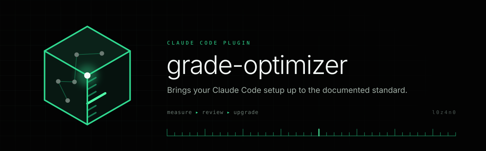
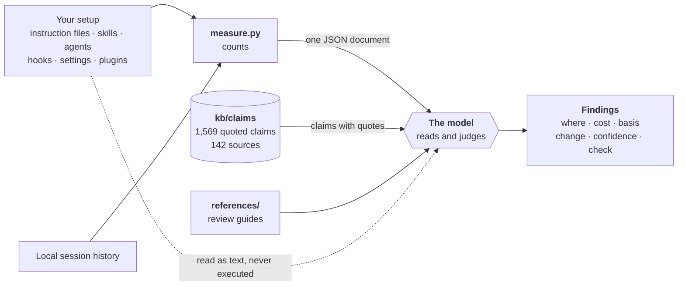
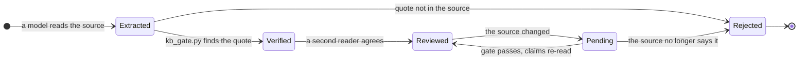

<p align="center">
  
</p>

<p align="center">
  <a href="https://github.com/l0z4n0-a1/skill-anthropic-grade-optimizer/actions/workflows/ci.yml"></a>
  
  
  
  <a href="LICENSE"></a>
</p>

<p align="center">
  <a href="#install">Install</a> ·
  <a href="#first-review">First review</a> ·
  <a href="#how-it-works">How it works</a> ·
  <a href="#where-it-runs">Where it runs</a> ·
  <a href="#what-has-been-measured">Evidence</a> ·
  <a href="docs/example-report.md">Example</a> ·
  <a href="docs/architecture.md">Architecture</a> ·
  <a href="docs/reference.md">Reference</a>
</p>

# grade-optimizer

A Claude Code plugin that reviews how you have set Claude Code up. It measures
what your setup loads, what that costs and what actually gets used, then reads
the setup the way a careful colleague would and tells you what to change, with
the published source for each recommendation quoted beside it.

It is an independent project. It is not affiliated with, endorsed by or
sponsored by Anthropic. See [NOTICE.md](NOTICE.md).

```
  measure                read                    report
  ───────                ────                    ──────
  what loads             the setup as a system   what to change, largest first
  what it costs    ──▶   against 1,569 quoted ──▶ the source quoted beside it
  what gets used         claims                  how to tell it worked
```

## What it reviews

| You ask for | It does | Guide it follows |
|---|---|---|
| "Review my Claude Code setup" | Reads the whole setup as one system: instruction files, skills, subagents, hooks, settings, plugins, and 30 days of local session history | [setup-review.md](references/setup-review.md) |
| "Review the skill at `<path>`" (or a subagent, hook or instruction file) | Reads one piece in depth: will it be picked when it should, and will it produce good work | [piece-review.md](references/piece-review.md) |
| "Fit my setup to `<model id>`" | Says what to change, remove and add when the model reading the setup changes | [model-fit.md](references/model-fit.md) |
| "Review the process in `<dir>`; its run records are in `<dir>`" | Reads an orchestration process built on Claude Code (a runner, a workflow, a review loop) against its own run records: what it guarantees, what its checks can and cannot catch, where it spends | [process-review.md](references/process-review.md) |
| `/grade-optimizer:update` | Checks whether the published sources changed since the knowledge base was built, and which claims that puts in doubt | [commands/update.md](commands/update.md) |

A review changes nothing unless you ask it to. A setup with
little wrong gets a short report that says so.

Claude Code ships checks of its own, and this plugin builds on them instead of
repeating them: `/doctor` for installation health, `/doctor prompt-audit` for
instruction text written for older models, `/usage` and `/context` for where
tokens go. Those look at one thing at a time. This plugin looks at how the
pieces work together.

## How it works

Three parts, each doing the one thing it is good at.



```
scripts/measure.py      counts     pieces, when each loads, context cost, recent usage
kb/claims/*.jsonl       remembers  1,569 statements from 142 published sources, each
                                   with a verbatim quote, a source and a fetch date
SKILL.md + references/  judges     the model reads your setup with the measurement
                                   and the relevant claims, and reports findings
```

**Scripts count.** Anything that can be counted is counted by a script, so the
model never estimates what could be measured. Some of the figures are
themselves estimates (tokens for a file are characters divided by four) and
are labelled as such; what the script cannot see is listed in its output under
`not_measured`.

**The knowledge base remembers** what a model may get wrong from memory: how
Claude Code behaves, what each current model needs, and what Anthropic's
published material recommends, in its own quoted words. Each claim is the
plugin's one-line summary; the quote beside it is the source's text. Most
sources are Anthropic's documentation; the rest are its engineering posts, the
reference files of its open-source `claude-api` skill, and one published
conversation with its staff, whose claims are marked as that person's account.
`scripts/kb_gate.py` checks each quote against a snapshot of its source and
rejects a claim whose quote is not there.

**The model judges.** Whether a subagent's brief is good enough is not
something a rule list settles. Each finding says where it is, what it costs
you, what it rests on (claim ids, a named principle from
[foundations.md](references/foundations.md), or the reviewer's own judgment,
always labelled), the exact change, how sure the reviewer is, and how to tell
whether the change worked.

### What a finding looks like

The shape below is fixed; the content is an illustration, built on a real
claim (`python scripts/kb.py cite hooks-030` prints it).

```
┌─ FINDING ────────────────────────────────────────────────────────────────┐
│ where       CLAUDE.md:41  "Always run the formatter after editing."      │
│ what        A rule that must hold every time is written as prose, so it  │
│             holds only when the model chooses to follow it.              │
│ basis       hooks-030                                                    │
│             "which gives you deterministic control: certain actions      │
│             always happen rather than relying on the LLM to choose to    │
│             run them."                                                   │
│             code.claude.com/docs/en/hooks-guide.md                       │
│ change      Move it to a PostToolUse command hook; delete the line.      │
│ confidence  High. Wrong if the formatter is meant to be optional.        │
│ check       Edit a file without asking for formatting; it is formatted.  │
└──────────────────────────────────────────────────────────────────────────┘
```

The quote is the source's words. The reviewer reads it, not the claim's
one-line summary, before a finding rests on it, and you can check it yourself
at the link. A whole report, unedited, is in
[docs/example-report.md](docs/example-report.md).

## Requirements

- Claude Code, with any way of signing in it supports: a Claude subscription
  or an API key. The plugin makes no model calls of its own.
- Python 3.9 or later on the path. Standard library only; nothing to install.

## Install

From the marketplace this repository hosts:

```
/plugin marketplace add l0z4n0-a1/skill-anthropic-grade-optimizer
/plugin install grade-optimizer@l0z4n0-a1-skills
/reload-plugins
```

Or try it for one session without installing, from a clone:

```bash
git clone https://github.com/l0z4n0-a1/skill-anthropic-grade-optimizer.git
claude --plugin-dir ./skill-anthropic-grade-optimizer
```

This marketplace does not update on its own by default. Either turn on auto-update for `l0z4n0-a1-skills` under `/plugin` →
**Marketplaces**, or run `claude plugin update grade-optimizer@l0z4n0-a1-skills`
in your shell when you want a new version. [CHANGELOG.md](CHANGELOG.md) lists
each release.

Before installing any plugin, read what it runs. This one has no hooks, no MCP
server and no background process; it has five scripts, described under
[What the scripts touch](SECURITY.md#what-the-scripts-touch).

## First review

In a Claude Code session opened in the project you care about:

```
/grade-optimizer:grade-optimizer review my Claude Code setup
```

Or just ask in your own words ("audit my setup", "why does Claude keep picking
the wrong agent?"); the skill's description lets Claude pick it up. Unless
your permission settings already allow it, Claude asks before running the
measurement script. The report comes back in the conversation, in the
language you are writing in; ask for a file if you want one.

For one piece, give its path. For a process (anything that drives Claude Code
through repeated runs: a script that launches sessions, a workflow, a review
loop), name three things: where its code lives, the project it works on, and
where it keeps its run records, meaning whatever it leaves behind per run
(logs, transcripts, verdicts, receipts).

```
/grade-optimizer:grade-optimizer review the subagent at .claude/agents/reviewer.md
/grade-optimizer:grade-optimizer review the process in tools/runner; it works on this repo and its records are in tools/runner/runs
```

## Where it runs

| Surface | Works | Notes |
|---|---|---|
| Claude Code, interactive | Yes | The surface it is built and calibrated for |
| Claude Code, headless (`claude -p`) | Yes | Load with `--plugin-dir <path>` or from your installed plugins; allow the tools it needs, since a headless run cannot ask. With `--bare`, installed plugins are skipped, so pass `--plugin-dir` |
| Claude Agent SDK | Yes, same engine | Pass the plugin with the `plugins` option; example below. Not separately calibrated |
| Claude API and claude.ai, as an uploaded Agent Skill | Not supported | The skill's name and layout meet the upload rules, but there the code runs in a container that cannot see your Claude Code setup or its session history, and on the API it has no network. Setup review, measurement and the update check have nothing to read |

A headless review:

```bash
claude -p "/grade-optimizer:grade-optimizer review this setup and write the report to the terminal" \
  --plugin-dir ./skill-anthropic-grade-optimizer \
  --allowedTools "Read,Glob,Grep,Bash(python *),Bash(python3 *),Bash(py *)" \
  --disallowedTools "Edit,Write"
```

`--allowedTools` approves those calls without asking, and a headless run
starts the project's hooks and MCP servers without a trust prompt, so run it
in a project you trust. Denying Edit and Write keeps the review from changing
files through those tools; it does not stop a Python command it is allowed to
run from writing, which is why the rule names Python and nothing broader. A
command outside those rules, such as a shell loop, is denied and the review
carries on without it.

From the Agent SDK (Python; `pip install claude-agent-sdk`):

```python
import asyncio
from claude_agent_sdk import ClaudeAgentOptions, query

async def main():
    options = ClaudeAgentOptions(
        plugins=[{"type": "local", "path": "./skill-anthropic-grade-optimizer"}],
        allowed_tools=["Read", "Glob", "Grep", "Bash(python *)"],
        disallowed_tools=["Edit", "Write"],
    )
    async for message in query(
        prompt="/grade-optimizer:grade-optimizer review the skill at .claude/skills/deploy",
        options=options,
    ):
        if type(message).__name__ == "ResultMessage":
            print(message.result)

asyncio.run(main())
```

The TypeScript SDK takes the same `plugins` option; see
[Plugins in the SDK](https://code.claude.com/docs/en/agent-sdk/plugins).

## The measurement on its own

`measure.py` is useful without the review: it prints a summary of a setup and,
with `--out`, writes the full measurement as one JSON document.

```bash
python scripts/measure.py --project <your project> --out <dir outside any repo>/before.json
# ... change things, work for a while ...
python scripts/measure.py --project <your project> --compare <dir outside any repo>/before.json
```

The comparison needs a baseline taken the same way: same user directory,
project, `--days` window and read options. Keep the output out of any repository. The script never copies `env` values,
MCP server arguments or message text, but what it does copy (descriptions,
hook commands, permission rules) it copies as written, so a secret typed into
one of those ends up in the file. Treat the JSON like the files it was read
from, and remember that opening it in a Claude session sends its contents to
that session. [SECURITY.md](SECURITY.md) lists exactly what is read.

`python scripts/measure.py --help` lists every option;
[docs/reference.md](docs/reference.md) describes the output.

## The knowledge base on its own

```bash
python scripts/kb.py core                        # the review questions and the principle behind each
python scripts/kb.py core placement              # the claims to read first for one question
python scripts/kb.py show hooks,settings --brief # one line per claim on a topic
python scripts/kb.py model claude-opus-5-5       # what is specific to one model
python scripts/kb.py cite hooks-030              # the full record, with quote and source
```

The sources' full text is not in this repository; it holds short quotes,
links and content hashes. `kb/sources.json` lists every source and
`kb/snapshots.lock.json` records when each was last downloaded, which is not
the same as when its claims were last reviewed: see
[Keeping it current](#keeping-it-current).

## Keeping it current

The knowledge base quotes pages that change every week.

```
/grade-optimizer:update
```

downloads each source, compares it with the hash recorded at its last
download, and reports which sources changed, how many claims rest on each, and
which pages appeared or disappeared. A source that changed and has not been
re-read yet is also listed in `kb/pending.json`, so a later download cannot
hide it. The check writes nothing inside the plugin. A changed source does not
mean its claims are wrong; it means nobody has looked since.

`/grade-optimizer:update evolve` goes further, and only in a writable git
clone loaded with `--plugin-dir`: it brings the knowledge base up to date on a
branch for you to review.

Downloaded is not reviewed. A claim moves through these states, and a script
attests each arrow except the one a reader has to make:



While a source is pending it stays listed in `kb/pending.json`, and `kb.py`
prints a notice beside every claim that rests on it.
[maintaining.md](references/maintaining.md) is the procedure.

## What has been measured

Stated with its base, because a rate without one is decoration.

- **Quotes.** All 1,569 claims pass the quote check, run with the snapshots of
  all 142 sources present: the quoted text is in the source snapshot. That proves the quote exists, not that the claim summarises
  it faithfully.
- **Fidelity.** Two readers from different model families independently read
  the same random sample of 60 claims. 49 drew no objection from either; the
  other 11 omitted a condition or overstated scope and were corrected. One
  reader alone had passed all 60. The sample says nothing certain about the
  claims outside it, which is why the skill has the reviewer read the quote,
  not the summary, before a finding rests on a claim.
- **Reviews.** `evals/` builds throwaway setups and processes with planted
  defects and an answer key, and clean ones where the right result is no
  invented finding. In blind runs of the process review, the reviewer found 8
  to 9 of 10 planted defects. On the clean process, round 1 had one untrue
  finding and rounds 2 to 4 none, but in two of those rounds the reviewer presented 2 or 3 known, acceptable costs as
  defects. [evals/README.md](evals/README.md) has every round, including the
  one that got worse and why.

## Limits

- A review is a model's judgment. It can be wrong; each finding says how sure
  it is and how to check.
- Usage figures come from the session history on this machine. Claude Code
  deletes session files older than `cleanupPeriodDays`, 30 days by default.
- The knowledge base is as current as the release that last reviewed it; for
  2.1.0 that was 2026-11-27, and `kb/snapshots.lock.json` dates each source. A
  model released after that is not covered, and the review says so.
- The calibration fixtures were written by the maintainer, who also wrote the
  guides. A process the maintainer has never seen is the independent test, and
  so far the process review has been run on only one.
- Calibration was run on Claude Code interactive sessions only.

## Documentation

| | |
|---|---|
| [docs/example-report.md](docs/example-report.md) | A complete review, unedited, of a setup with ten planted defects, and how it scored |
| [docs/architecture.md](docs/architecture.md) | How the parts fit, the trust boundaries, each design decision and the alternative it rejected; glossary |
| [docs/reference.md](docs/reference.md) | Every script: options, exit codes, output format; every data file: fields and what validates them |
| [docs/troubleshooting.md](docs/troubleshooting.md) | Symptom, cause and fix for install, permissions, headless runs and the scripts' exit codes |
| [references/](references/) | The review guides the skill follows, and the principles behind them |
| [references/maintaining.md](references/maintaining.md) | Updating the knowledge base |
| [evals/README.md](evals/README.md) | Calibration: how to run it and what it has shown |
| [CONTRIBUTING.md](CONTRIBUTING.md) · [SECURITY.md](SECURITY.md) · [CHANGELOG.md](CHANGELOG.md) · [NOTICE.md](NOTICE.md) | |

Version 1 was a rule engine that scored single artifacts against a list of
cited rules; it remains at the `v1.0.0` tag.

## License

MIT for the project's own material. Quoted excerpts belong to their authors:
see [NOTICE.md](NOTICE.md).
