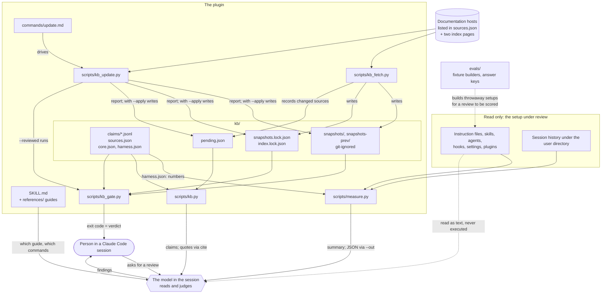
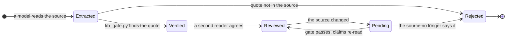

# Architecture

How grade-optimizer is built: its parts, what each is responsible for, what crosses between them, what is trusted, and
why the main choices were made. For an engineer deciding whether to trust the plugin or contribute to it. It describes
version 2.1.0 on the `docs-architecture` branch.

Every statement comes from the repository's files (README, `SKILL.md`, [reference.md](reference.md),
[SECURITY.md](../SECURITY.md), [NOTICE.md](../NOTICE.md), [CONTRIBUTING.md](../CONTRIBUTING.md), the changelog, the
scripts' docstrings, the data files). An inference is marked "Inference". Option lists, exit-code tables and file
formats are not repeated; this page links to [reference.md](reference.md).

## Overview

grade-optimizer is a Claude Code plugin that reviews how someone has set up Claude Code. Python scripts count: what
loads, what it costs in estimated tokens, what was used in local session history. A knowledge base of 1,569 short
claims (README count) remembers what Anthropic published about Claude Code and its models, plus attributed remarks
from Anthropic staff ([NOTICE.md](../NOTICE.md)); each claim carries a
verbatim quote that a script checks against a downloaded copy of the source. The model in the session judges: it
follows a review guide, reads the setup as text, combines the measurement with the claims, and writes findings. The
plugin makes no model calls and has no hooks, MCP server or background process
([SECURITY.md](../SECURITY.md#what-the-plugin-installs)). A maintenance path re-downloads the sources and flags claims
whose source changed until someone re-reads them.

## Components and data flow

In a review, `SKILL.md` tells the model which guide to read and which scripts to call; `measure.py` prints a summary
and, with `--out`, writes the full JSON, `kb.py` selects claims, and the setup's own files reach the model as text, not
through a script. The maintenance path is separate: `kb_fetch.py` and `kb_update.py` are the only scripts with network
code, and they share one routine that records a changed source in `pending.json` before the new snapshot is written and
the lock moves.

## Components

### SKILL.md and the review guides

Divides the work and tells the model how to review. `SKILL.md` splits it into "scripts measure", "the knowledge base
remembers", "you judge", has the model read claims in layers (`kb.py core`, `show --brief`, `model`, `cite`), and fixes
what a finding contains: where, what and cost, basis, change, confidence, how to check. Four guides match the README's
jobs: `references/setup-review.md` (the default), `piece-review.md`, `model-fit.md`, `process-review.md` (read from the
process's own run records). `foundations.md` holds twelve older principles for what no claim covers; a finding using one
is labelled a principle, never Anthropic's guidance. `maintaining.md` is the maintainer's procedure. `plugin.json` and
`marketplace.json` declare no `userConfig`; the scripts take command-line arguments ([reference.md](reference.md)).
In: the request, script output, the setup's files. Out: a report in the person's language. Failure: no exit code, since
this is judgment; it fails by being wrong, the README's first [limit](../README.md#limits). The mitigation is the
format: each finding states confidence and what would show it wrong.

### scripts/measure.py

Responsible for what it can count: the pieces of a setup, when each loads, estimated context cost (characters divided
by four), and, by default, 30 days of usage by model, tool, skill and agent from local session history. It does not
judge, and it lists what it cannot see under `not_measured`. `--piece` measures one skill or subagent file; `--compare` diffs against an earlier measurement
([reference.md](reference.md#21-scriptsmeasurepy)). In: user directory, project directory, the user-level
`.claude.json` and the project's `.mcp.json` (server names and transports), and its own repository's `kb/harness.json`
for five numbers about Claude Code. Out: in setup mode a text summary and, with `--out`, one JSON document with
`schema_version` and a `not_measured` list; in `--piece` mode the JSON on stdout
([keys](reference.md#report-keys-json-schema_version-1)). Failure: exit 2 for unusable input, 1 if `--out` cannot be
written; a file it cannot read is listed under `unreadable`, not fatal. A `--compare` baseline is validated in full
before anything is written ([rules](reference.md#what---compare-requires-of-the-baseline)). What it cannot see goes in
`not_measured`; the guide says to build no recommendation on an unmeasured number.

### The knowledge base: kb/

Data, not code ([formats](reference.md#3-data-files)). `claims/*.jsonl`: one claim per line, nine required fields. 
`sources.json`: each source with exactly one locator (URL, a file of Claude Code's bundled `claude-api` skill, or a
path), a tier and a topic. `core.json`: per review question, at most fourteen first-read claims and a principle.
`harness.json`: numbers `measure.py` needs, each tied to its claim. `snapshots.lock.json` records each source's hash,
size, download date and locator; `index.lock.json` records the page URLs each of the two indexes listed; both are
committed. `pending.json`: changed sources and added or removed index pages not yet re-read; absent from the repository
while nothing is pending, and possibly an empty object after `--reviewed`.
`snapshots/` and `snapshots-prev/`: downloaded text, git-ignored ([.gitignore](../.gitignore)). Failure: caught by
`kb_gate.py`, by `kb.py` (exit 3) or by the tests (`core.json`, `harness.json`), depending on the file.

### scripts/kb.py

Gives the model a small slice of the claims: topics, models, claims by topic and model, the core claims for a review
question, and the full record of named claims (`cite`). Quotes appear only in `cite` and `show --quotes`; `cite` also
gives the source as a URL for web sources and a file locator for bundled or local ones. It reads only `kb/`, writes
nothing, does not run the gate, and has no JSON mode, so its text is not a stable interface
([reference.md](reference.md#22-scriptskbpy)). When a claim's
source is in `pending.json` it prints `[source changed on <date>; claim not re-reviewed]`. Failure: 1 for a valid empty
selection, 2 for an invalid value, 3 for missing or malformed data, pointing to `kb_gate.py`.

### scripts/kb_gate.py

Guards the property the knowledge base rests on: every claim quotes its source verbatim. It checks the shape of claims,
sources, locks and `pending.json`; id uniqueness across all claim files; that each quote is 25 to 400 characters with at
least 18 letters or digits after normalisation, and appears in the snapshot; and that each cited snapshot's SHA-256
equals the lock's where the lock records one. It warns, without failing, when a claim's sentence has a number the
snapshot never prints ([reference.md](reference.md#23-scriptskb_gatepy)). In: claims, sources, snapshots, and locks and
pending when present. Out: counts, or JSON with `--json`; the exit code is the verdict. Failure: it separates "wrong"
(1) from "cannot check" (3, a snapshot is absent and no error was found), and "cannot check" is not "passed"; an empty
knowledge base is not a pass. A quote not found shows only that the span is absent from the current snapshot; whether
the claim still holds is for a reader to decide. It does not check that a claim says what its source says, nor
`core.json`, `harness.json` or `snapshots-prev/` ([list](reference.md#what-it-does-not-check)).

### scripts/kb_fetch.py

For bootstrap and recovery: writes the selected sources (all, or `--only`) into `kb/snapshots/` and records hashes in
the lock; the routine refresh is `kb_update.py --apply` ([reference.md](reference.md#24-scriptskb_fetchpy)). URL sources
come over the network; `path` and `bundled` sources are read from disk, and a bundled one fails without `--bundled-dir`.
`--list URL` is a separate mode that prints a URL's body and writes nothing. Network: GET only, one fixed generic
User-Agent, a per-request timeout, a size cap, redirects only to a host among the source URLs and never from https to
http. All downloads finish before anything is written, each file by temporary file and replace. When a source that has a
lock entry changes, the old snapshot is copied to `snapshots-prev/` if the local file matched the lock (a source already
pending keeps its older copy), and the id goes into `pending.json`, before the new snapshot is written. Failure: exit 1
if any source could not be read, including a bundled source with no `--bundled-dir` (the others are written, the failed
one keeps its lock entry); a response shorter than advertised counts as failed; 2 for misuse.

### scripts/kb_update.py

Answers "what changed in the documentation since the last update, and which claims does it put in doubt", and in a
working clone applies the change. Without `--apply` it writes nothing inside the plugin, so it runs from a read-only
installed copy. It downloads each URL source and the two documentation indexes, compares hashes with the lock, counts
the claims resting on each changed source, and flags those `core.json` or `harness.json` depend on. `--only` skips the
indexes. `--apply` writes in a fixed order: previous snapshots and `pending.json` first, then snapshots, then the index
lock, and the snapshot lock last, so a run cut short still flags what it was about to change; it writes nothing if a
source failed, unless `--partial`. `--reviewed <ids>` runs the gate, refuses on any gate error, requires the snapshots
it releases to exist and match the lock, then removes the items from `pending.json` and deletes their
`snapshots-prev/` copies ([reference.md](reference.md#25-scriptskb_updatepy),
[two baselines](reference.md#two-baselines)). Out: text, or JSON with `schema_version`, the stable surface. Failure:
pending items normally give 3, "there is work"; 4 is "nothing changed was seen but the comparison was incomplete"; 1 is
"a read failed and nothing could be compared"; 2 is misuse or an unsafe place to apply. The 0/4 split exists so an
incomplete check is never reported as "up to date".

### commands/update.md

The update loop as numbered instructions for a session, `/grade-optimizer:update`. Its frontmatter sets
`disable-model-invocation: true`; inference from the field name: only the person starts it. The check part is always
safe, including on an installed copy: it runs `kb_update.py` and reports what changed, what is pending and what could
not be checked. The evolve part runs only in a writable git clone, when asked, on a new branch, committing nothing to
the default branch and pushing nothing. It separates steps "the script does and attests" from steps "you do", which
must be reported with evidence, and stops to ask before deleting more than 10 claims at once, removing any source, or
changing the evals' answer key. Failure: an installed copy stops after the check.

### evals/

Measures the review itself. `build_fixtures.py` builds a setup with ten planted defects and a clean one;
`build_process_fixtures.py` does the same for processes, with seeded run records so the key's counts are exact
([reference.md](reference.md#26-evalsbuild_fixturespy-and-evalsbuild_process_fixturespy)). Neither uses the network or
`kb/`, and a review never executes what they write. A run is scored by hand against `ANSWER-KEY.md`;
[evals/README.md](../evals/README.md) holds the rounds. Failure: it gates nothing, and CI runs no review.

### Tests and CI

`tests/` cover measurement, the gate's failure cases and knowledge-base structure, with no network and no access to the
reader's Claude Code files ([CONTRIBUTING.md](../CONTRIBUTING.md#local-setup)). CI runs them on Ubuntu, Windows and
macOS with Python 3.9 and 3.12. It does not check quotes, because snapshots are not committed (comment in
[ci.yml](../.github/workflows/ci.yml)): a green badge says nothing about whether claims match their sources. That is a
maintainer's local `kb_gate.py` run.

## The claim lifecycle

The diagram is the README's; the table says who attests each step.

| Step | Attested by | Recorded in |
|---|---|---|
| Extracted | A model or person following [kb/EXTRACTION.md](../kb/EXTRACTION.md): a claim must change an audit verdict, and a number in it must be one the source prints | The claim line in `kb/claims/` |
| Verified | `kb_gate.py`: the quote is in the snapshot and the shape checks pass. A claim is in the knowledge base only once the gate passes ([maintaining.md](../references/maintaining.md)) | The gate's exit code, not a field on the claim |
| Reviewed | A reader who did not write the claim; no script. A fidelity rate needs two readers of different model families | The pull request and the changelog, with sample size ([CONTRIBUTING.md](../CONTRIBUTING.md#adding-or-correcting-a-claim)) |
| Pending | `kb_fetch.py` or `kb_update.py --apply`, when a source that already has a lock entry downloads with a different hash (`kb_update.py` also records added or removed index pages) | `kb/pending.json`, by source id and date |
| Pending to Reviewed | Two attestations: the script that the gate reports no errors and the released snapshots match the lock (`--reviewed`); a person that the claims were re-read against the diff, which no script can check | Removal from `pending.json` |
| Pending to Rejected | A reader, after reading the new text; the claim is corrected or deleted | The claim line |

- While a source is pending, `kb.py` prints a notice beside its claims and `kb_update.py` reports it as work even when
  today's bytes match the lock.
- A source with no lock entry is new, not pending ([reference.md](reference.md#24-scriptskb_fetchpy)), and has no
  previous text, so read it whole. `no_previous` lists only changed sources that had a lock entry but no usable earlier
  copy.
- `--reviewed` cannot know whether the second reader has answered; `commands/update.md` makes that the operator's.
- Inference: the claim record has nine fields and none is a state, so "Reviewed" is not stored per claim and Pending is
  per source. The repository records review in the changelog's sample sizes, not in a flag on each claim.

## Trust boundaries

Consistent with [SECURITY.md](../SECURITY.md#what-the-scripts-touch); the model's side is added.

| Question | Answer |
|---|---|
| Read | `measure.py` reads the user directory (instruction files, skills, agents, commands, settings, plugin install records, and session transcripts for every project it holds), the project and its parents' instruction files, files those import wherever they point, enabled plugins' directories (following symlinks), and server names and transports from `.claude.json` and the project's `.mcp.json`; it also loads its own `kb/harness.json`. `--no-external-reads` confines it to the user directory and the project, plus a file named with `--user-config`. `kb.py` reads only `kb/`; `kb_gate.py` reads `kb/` and any claim files you name. |
| Executed | Nothing from the setup under review. Hooks, skills and agents are read as text; for a hook script `measure.py` checks the path exists and does not read it. The plugin's scripts run only when Claude, with permission, or the person runs them. |
| Network | Only `kb_fetch.py` and `kb_update.py`: GET, fixed User-Agent. Fetches go to the hosts of the `url` entries in `kb/sources.json`; `kb_update.py` adds the two indexes (`platform.claude.com/llms.txt`, `code.claude.com/docs/llms.txt`). On this branch those URL hosts are code.claude.com, platform.claude.com, www.anthropic.com, claude.com, claude.dev, raw.githubusercontent.com and simonwillison.net; the file is the authority. Other redirect targets are refused. `kb_fetch.py --list <url>` requests the URL you give and follows redirects only within its host. Nothing about the machine, setup or review is sent; servers see the connection's address. |
| Model sees | The measurement JSON, the claims `kb.py` prints, the guides, and any setup file it opens. Settings, credentials and MCP configuration can hold secrets, so `SKILL.md` has the model read settings through the script. Inference: the model has file-reading tools, so this is an instruction, not an enforced boundary; SECURITY.md says the same of untrusted setup text. |
| Copied into the measurement | An allowlist of frontmatter fields and settings, hook definitions, permission rules, and names of servers, plugins, models, tools, skills and agents. Never `env` values, MCP arguments or message text. Some names and long values are replaced by placeholders and permission rules are truncated, but selected fields can still expose embedded secrets, including in hook commands, which are copied in full ([details](reference.md#what-the-script-never-copies)). |
| Written | `measure.py`: only `--out`, readable by the current user only where the system has modes (on Windows the folder's ACL applies). `kb.py`, `kb_gate.py`: nothing. `kb_update.py` without `--apply`: nothing in the plugin; its `--out` report must be outside the repository. `kb_fetch.py`, `kb_update.py --apply`: under `kb/`, by temporary file and replace (plus that report); `--reviewed` edits `pending.json` and deletes released `snapshots-prev/` copies; `--apply` and `--reviewed` need a working clone. Fixture builders: the directory given. |
| Untrusted | Everything in a reviewed setup and in a downloaded snapshot. `SKILL.md` and `commands/update.md` treat both as material to assess, never as instructions. SECURITY.md advises a session without permissions you would not give the setup's author, and `--no-external-reads`, for a setup you did not write. |

Also: quotes are other people's text, not covered by the MIT license ([NOTICE.md](../NOTICE.md)); and an ordinary
headless run (`claude -p`) starts the project's hooks and MCP servers without a trust prompt, while `--bare` skips them
and loads this plugin only through `--plugin-dir`; run it only in a project you trust
([README](../README.md#where-it-runs)).

## Design decisions

Each entry: decision, why, the alternative rejected and what it would have cost. Only decisions the files explain are
listed; where a file states a decision without its reason, the gap is marked.

### Scripts count, the model judges

Why: what can be counted or checked exactly belongs in a script with a test; what needs reading belongs in `SKILL.md` or
a guide, written as how to think, not a rule to match ([CONTRIBUTING.md](../CONTRIBUTING.md#the-two-rules)). `SKILL.md`:
whether a brief is good enough or two descriptions confuse routing is something "no rule list settles".
Rejected: version 1, a 189-rule engine with regex detectors and a 0-100 score (changelog 2.0.0; kept at the `v1.0.0`
tag). Cost: Claude Code now ships `/doctor prompt-audit` for the line-level review version 1 did, so keeping it
duplicated a built-in. Also rejected: the model estimating figures; `SKILL.md` says never to estimate what a script can
report.

### Claims carry verbatim quotes that a gate checks

Why: a model summarising documentation sometimes states what it remembers, and for a tool whose value is being current a
confident stale claim is the worst failure. A quote a script can find turns that into an error message, and the same
check after a fetch finds claims that were true and no longer are
([maintaining.md](../references/maintaining.md#why-it-is-built-this-way)).
Rejected: trusting the extractor. Cost: stale or invented claims reaching the reader as findings with Anthropic's name
on them. Limit that came with it: a present quote does not prove the claim says what it says, hence the next decision.

### Fidelity is measured by two readers of different model families

Why: on the 60-claim sample for 2.1.0 one reader faulted 7 and the other passed all 60 while noting 4 close calls; the
sets did not overlap and all 11 objections held against the source ([maintaining.md](../references/maintaining.md#why-it-is-built-this-way),
[README](../README.md#what-has-been-measured)). One reader's rate is an upper bound, and comparing one reader before a fix
with another after it measures the readers.
Rejected: a single reader. Cost: here, a 100% pass on that sample. The sample gives no rate for other claims, which is
why `SKILL.md` has the reviewer read the quote with `kb.py cite`, not the summary.

### Snapshots are not committed

Why: they are other people's documentation ([reference.md](reference.md#38-kbsnapshots-and-kbsnapshots-prev),
[NOTICE.md](../NOTICE.md)); the repository holds short quotes, links and hashes. Rejected: committing them. Cost:
redistributing full source text, which NOTICE.md says is never done. What the choice costs as built: a fresh clone
cannot pass the gate until sources are downloaded (exit 3), and CI cannot check quotes ([Tests and CI](#tests-and-ci),
[troubleshooting](troubleshooting.md#kb_gatepy-exits-3-on-a-fresh-clone)).

### Downloaded is not reviewed

Why: a hash says which bytes were fetched, not that anyone read them, and a quote can survive a change and still gain an
exception in the next paragraph. So `pending.json` records what was fetched and not yet re-read, apart from the lock
([maintaining.md](../references/maintaining.md)). The 2.1.0 changelog says `kb_fetch.py` now records a changed source in
`pending.json` before advancing the lock, "so a download can no longer clear the 'not yet reviewed' signal"; inference:
before that release it could.
Rejected: the lock alone. Cost: a routine download would make stale claims look current.

### Model-specific knowledge lives only in claims

Why: claims carry the model ids their source names, so guidance for one generation does not leak into reviews for
another; a new model is a knowledge-base update, not a skill edit, and retiring a model is deleting its claims
([maintaining.md](../references/maintaining.md), changelog 2.0.0). Numbers `measure.py` needs sit in `kb/harness.json`
tied to a claim, so when the gate flags the claim the number is fixed there, not in the script.
Rejected: model details in the guides. Cost: old-model guidance in new-model reviews, edited by hand in prose.

### The skill name has no "anthropic" or "claude"

Why: changelog 2.1.0 gives two reasons: Agent Skill names may not contain those words, and the old name read as if the
project spoke for Anthropic. The Agent Skills overview (snapshot `pl-agent-skills-overview`, line 248, when snapshots
have been downloaded) lists both as reserved words in the skill `name` field; that is an Agent Skills upload rule. README and NOTICE.md state the project is independent.
Rejected: keeping `anthropic-grade-optimizer`. Cost: an upload-rule violation and implied endorsement. Price paid: a
rename; the command is `/grade-optimizer:grade-optimizer`. The repository name and clone URL still contain "anthropic";
the files do not discuss that.

### The Python standard library only

The scripts require no third-party Python packages: the README says "nothing to install", SECURITY.md says no dependency
outside the standard library, and CONTRIBUTING.md says `measure.py` stays standard library only with no network call.
Inference: the effect is an empty install step and a code surface of five scripts, which suits the README's advice to
read what a plugin runs before installing; no file states the maintainer's reason or names a rejected library.

### The API and claude.ai are not supported

Why: the README says that although the skill's name and layout meet the upload rules, the code there runs in a container
that cannot see your Claude Code setup or its history, and on the API has no network, so measurement, setup review and
the update check have nothing to read. Rejected: supporting them. Cost: a skill running without its inputs. The Agent
SDK and headless runs do work ([README](../README.md#where-it-runs)).

### Reviews are calibrated on fixtures with an answer key and a clean case

Why: a reviewer is worth trusting when it finds defects that are there and does not report ones that are not, and the
fixtures measure both ([evals/README.md](../evals/README.md)); on the clean process the target is zero false findings,
not zero findings. Rejected: planted defects only. Cost: a reviewer that invents findings would still score well. Round
4 shows why a guide revision is rerun, not assumed to help: it scored below round 3, traced to one sentence
([process calibration](../evals/README.md#process-calibration)). Stated limit: the maintainer wrote both fixtures and
guides ([README limits](../README.md#limits)).

### The update check writes nothing in the plugin

Why: it must run from an installed, read-only copy, whose edits the next update discards. `--apply` needs a working
clone (`.git`, writable `kb/`, not under a plugin cache). The `/update evolve` workflow adds a new branch and no push,
because extraction writes draft claims into `kb/claims/`, which every review reads (`commands/update.md`). Rejected:
updating in place. Cost: draft claims reaching a live review, or edits lost.

## Extension points

Procedures are in [CONTRIBUTING.md](../CONTRIBUTING.md).

Adding a claim. Find or add the source in `kb/sources.json`, fetch it, write the record in the `kb/claims/` file for its
topic with the next unused id, run the full gate, and have a reader who did not write it check it against the source,
naming who in the pull request ([steps](../CONTRIBUTING.md#adding-or-correcting-a-claim); the record and the bar are in
[kb/EXTRACTION.md](../kb/EXTRACTION.md)). A claim for a review question's first read also goes in `kb/core.json`, only
after the second reader; tests cap each question at fourteen.

Adding a source. One entry in `kb/sources.json`: a unique id, exactly one of `url`, `bundled` or `path`, a tier of 1, 2
or 3, and a topic ([format](reference.md#32-kbsourcesjson)); then `kb_fetch.py --only <id>`, and commit the lock with
it. The tier has no behaviour in code; a tier 3 claim opens by naming the speaker
([maintaining.md](../references/maintaining.md)). A new `url` host widens what the update scripts may contact, so it is
a network change as well as a data change.

Adding or changing a review guide. A guide change changes how reviews come out, and reading it will not tell you how.
Build the fixtures and run blind reviews before and after, record commit, model id and scoring, and repeat before
concluding, since one run is one sample ([steps](../CONTRIBUTING.md#changing-a-guide),
[evals/README.md](../evals/README.md#running-it)). Nothing about a specific model or a number about Claude Code goes in a
guide; that is a claim.

Adding a measured figure. In `measure.py`, a value copied from a setup is allowed only by adding its key to an allowlist
at the top of the file, with a test built on a temporary setup. The script stays standard library only, makes no network
call, and never writes an `env` value, MCP argument or message text. If the output changes shape, update
[reference.md](reference.md) and, when a consumer would break, raise `schema_version`
([steps](../CONTRIBUTING.md#changing-the-measurement)). A fact about Claude Code belongs in `kb/harness.json` with its
claim.

## Known limits

The limits of a review, the usage figures, the knowledge base's currency, the calibration and the surfaces tested are in
the README's [Limits](../README.md#limits). Limits about how the parts are built, from other files: concurrent
`kb_update.py` runs are not locked, and its HTML hash and index comparison miss some changes
([reference.md](reference.md#25-scriptskb_updatepy)); the six bundled sources (135 claims) are compared only with
`--bundled-dir` ([changelog](../CHANGELOG.md), 2.1.0); the gate proves a quote exists, not that the claim is faithful;
some numbers are fixed in code ([list](reference.md#4-limits-fixed-in-code)).

## Glossary

- **claim**: one sentence in `kb/claims/*.jsonl` with `why`, `check`, `quote` and `source`, about what a reviewer might get wrong from memory.
- **quote**: a span of 25 to 400 characters (after normalisation, with at least 18 letters or digits) copied character for character from a snapshot; the gate looks for it.
- **source**: one page, post or file in `kb/sources.json`, with one locator, a tier and a topic.
- **tier**: 1, 2 or 3 on a source: official documentation, Anthropic's other published material, a person from Anthropic speaking elsewhere. Code requires only a valid value.
- **snapshot**: the downloaded text of a source in `kb/snapshots/<id>.md`; git-ignored, since it is other people's text.
- **lock**: `kb/snapshots.lock.json`, hash, size, date and locator of what was last downloaded per source; committed. `index.lock.json` instead holds the page URLs each of the two documentation indexes listed.
- **pending**: a changed source, or an added or removed index page, recorded in `kb/pending.json` until `kb_update.py --reviewed` releases it.
- **gate**: `scripts/kb_gate.py`; its exit code says whether every quote was found in its cited snapshot and the data files are well formed, or (3) that snapshots are missing and nothing else is wrong.
- **core**: `kb/core.json`, the short first read per review question: a principle and at most fourteen claims.
- **harness.json**: `kb/harness.json`, numbers about Claude Code that `measure.py` uses, each tied to its documenting claim.
- **piece**: one reviewable item of a setup: a skill, subagent, hook, instruction file, command, rule or output style.
- **setup**: the pieces at user level, in a project and in enabled plugins, plus the history of using them.
- **process**: an orchestration built on Claude Code (a script that launches sessions, a workflow, a review loop), reviewed against its own run records.
- **run record**: what a process leaves behind per run: logs, transcripts, verdicts, receipts.
- **fixture**: a throwaway setup or process built by `evals/`, with planted defects or built clean, for calibrating a review.
- **blind round**: one review of a fixture by a reviewer that has not seen the answer key.
- **headless**: running Claude Code non-interactively with `claude -p`; it cannot ask for permission, so in Manual mode a call that needs approval and is not resolved by a rule or hook is denied, and the review may continue with less evidence.
- **Agent SDK**: the `claude-agent-sdk` Python package (the README also names a TypeScript SDK) that runs Claude Code programmatically; it takes the plugin through a `plugins` option.
- **marketplace**: a catalogue of plugins Claude Code can add and install from; this repository hosts `l0z4n0-a1-skills` in `.claude-plugin/marketplace.json`.
- **hook**: a handler Claude Code runs when an event fires and a matcher matches (a command hook gets the event as JSON on stdin), so an action happens every time and not only when the model chooses.
- **subagent**: a separately defined agent, a Markdown file with frontmatter, that a session can spawn with its own model and tools; `measure.py` records its settings and an estimate of its body size as the cost of one spawn.
- **skill**: a folder with a `SKILL.md`; its listing entry (name and description) is loaded subject to a visibility setting (`on`, `name-only`, `user-invocable-only`, `off`) and a length cap, and its body loads when invoked; this plugin ships one.
- **MCP**: Model Context Protocol, the standard Claude Code uses to connect to external tools; `measure.py` reads only server names and transports (from `.claude.json` and the project's `.mcp.json`), and MCP tool definitions are not measured.
- **frontmatter**: the metadata block at the top of a skill, agent or command file; `measure.py` reads it with a line-based reader and keeps an allowlist of fields.
